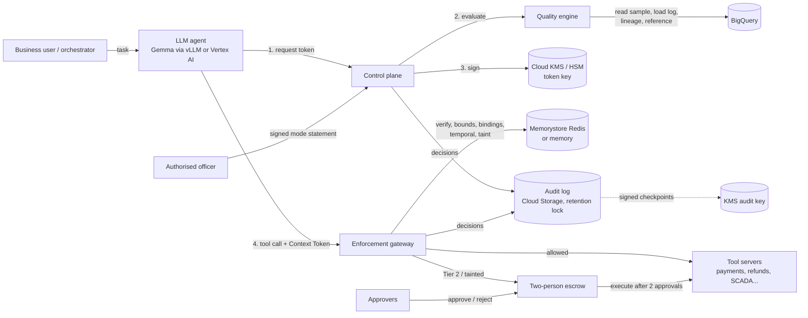
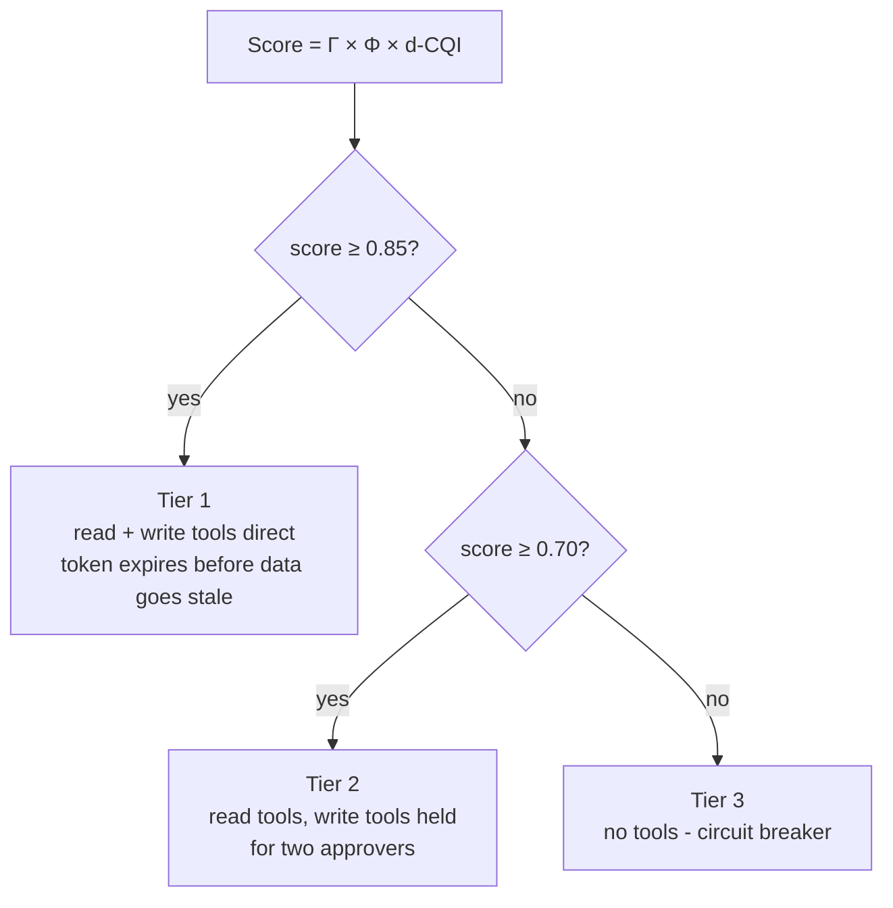
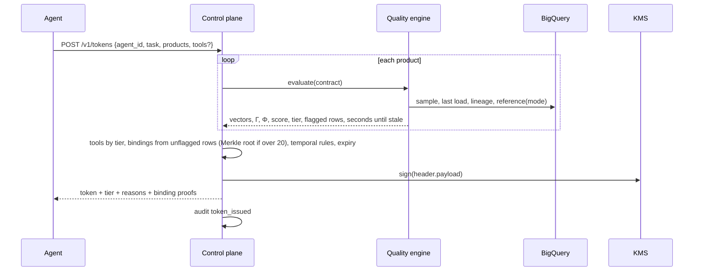
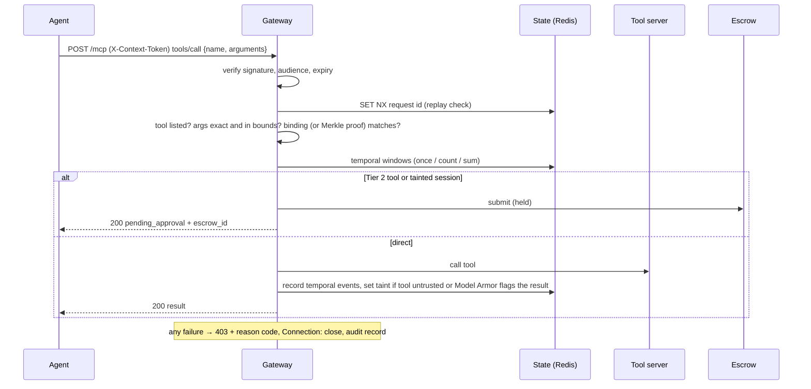
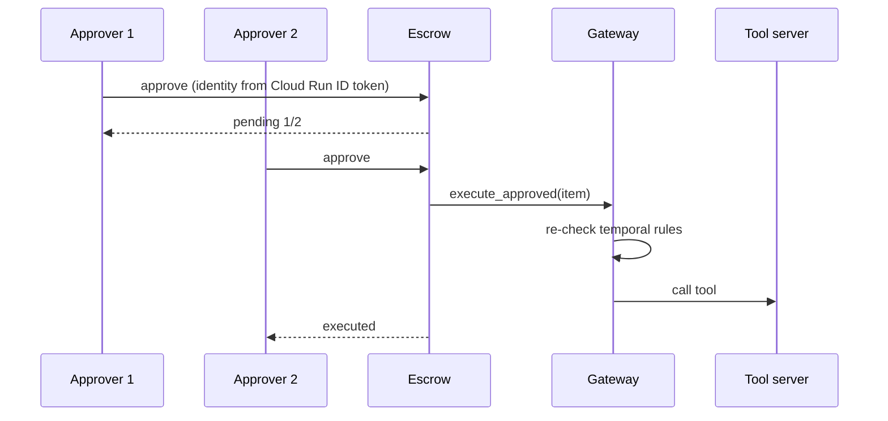

# 03 — Solution Design

## 1. Context

The agent never holds credentials for the tools. On Google Cloud, the tool service accepts calls only from the gateway's service account, so the only path to an action is through the gateway.

## 2. Components

| Component | Responsibility | Code | Google Cloud |
|---|---|---|---|
| Data contracts | Column semantics, rules, SLAs, tools, limits, temporal rules, modes | `cene/contracts.py`, `harness/contracts/*.yaml` | Shipped in the image (later: Dataplex aspects) |
| Data store | Product samples, load log, lineage health, reference profiles | `cene/datastore.py` | BigQuery dataset `cene` |
| Quality engine | Five vectors, zero-tolerance, gate, tier, time-until-stale | `cene/quality/` | Inside the control service |
| Mode registry | Signed, expiring switches between reference profiles | `cene/modes.py` | Inside control; oracle key in KMS |
| Control plane | Issue and delegate Context Tokens | `cene/control_plane.py` | Cloud Run `cene-control` |
| Enforcement gateway | Check every call; route to tool or escrow; taint; temporal state | `cene/gateway.py` | Cloud Run `cene-gateway` |
| Escrow | Two-person approval | `cene/escrow.py` | Inside gateway (later: Firestore) |
| Content screener | Screens read-tool results; a finding taints the session | `cene/screening.py` | Google Cloud Model Armor (optional) |
| Tool servers | Mock business systems | `cene/tools.py` | Cloud Run `cene-tools` |
| Audit log | Hash chain, signed checkpoints | `cene/audit.py` | Cloud Storage bucket with retention policy; KMS audit key |
| Agent runner | Multi-turn LLM loop through the gateway | `agent/runner.py` | Laptop, GPU VM or Cloud Run job |
| Harness | Data generation, faults, 12 scenarios, calibration, BigQuery loader | `harness/` | Run from laptop/Cloud Shell |

## 3. Capability tiers

A task that uses several products gets the **worst** tier among them. Γ = 0 (any zero-tolerance rule broken) always gives Tier 3.

## 4. Main flows

### 4.1 Token issue

### 4.2 Tool call

### 4.3 Escrow

### 4.4 Emergency mode

An officer holding `cloudkms.signerVerifier` on the **oracle** key signs `{product, mode, exp, reason}` (`python -m harness.sign_mode`). The control plane checks:
- the signature, against the oracle public key;
- the audience;
- the expiry;
- that the mode is declared in the contract.

The quality engine then compares data with that mode's reference profile until the statement expires. Neither the control plane nor the agent can sign mode statements.

### 4.5 Delegation

A parent token can be narrowed for a sub-agent: drop tools, lower numeric maxima, keep a subset of bindings. The child carries `parent` (hash of the parent token) and `depth`. Depth is capped at 2, and the child's expiry can't exceed the parent's.

## 5. Security architecture

| Boundary | Control |
|---|---|
| Agent ↔ tools | The agent has no tool credentials; tools accept only the gateway's service account (Cloud Run IAM) |
| Agent ↔ gateway / control | Cloud Run IAM (identity token in `Authorization`); Context Token in `X-Context-Token` |
| Token integrity | ES256 signature; key in KMS (SOFTWARE for development, HSM for production) |
| Key separation | Three keys: **token** (control signs), **oracle** (only named officers sign), **audit** (control and gateway sign checkpoints). Gateway can only read the token public key |
| Human approval | Approver identity from the verified identity token; the agent's identity can never approve |
| Evidence | Hash-chained audit records, signed checkpoints, bucket retention policy (lockable) |
| Data | Synthetic/public data only; arguments stored as hashes in the audit log |

**Residual risk in Stage 1:** the gateway enforces in user space. If an agent runs on a host that can reach tool APIs directly with its own credentials, the gateway can be bypassed. Stage 1 prevents this through IAM (the agent has no tool credentials). Stage 2 adds kernel enforcement so the boundary holds even inside a shared host.

## 6. Deployment topology

| Stage | Topology |
|---|---|
| 1a local | One process (`CENE_SERVICE=all`), in-memory everything, seeded from a scenario |
| 1b Google Cloud | Cloud Run: `cene-control` (max 1 instance without Redis), `cene-gateway` (max 1 without Redis), `cene-tools`; BigQuery; KMS keys; audit bucket; optional Memorystore + VPC connector |
| 1c agent | vLLM on a GPU VM (L4), or the Vertex AI OpenAI-compatible endpoint; agent runner on the VM or laptop |
| 2 kernel | Ubuntu 24.04 VM (kernel 6.8): eBPF enforcer next to the agent process; then GKE Standard DaemonSet |
| 3 load | GKE Standard cluster, k6 from a VM; delete afterwards |

## 7. Design decisions

| # | Decision | Why | Trade-off |
|---|---|---|---|
| D1 | ES256 (P-256) instead of Ed25519 | Supported by Cloud KMS and Cloud HSM with the same verify code locally and in the cloud | Slightly larger signatures; the Kaggle prototype used Ed25519 |
| D2 | Bindings list whole argument combinations; sets above 20 rows are committed by a signed Merkle root, and the agent attaches a per-row proof | Separate per-argument lists allow mix-and-match (invoice A paid to supplier B's real account). Inline lists made the UC01 token 32 KB; with a Merkle root it is 1.6 KB | The agent (runner) must attach the proof for the row it uses |
| D3 | Temporal state keyed by business keys, not by token | Limits must survive new sessions and new tokens | Needs shared state (Redis) to scale out |
| D4 | Freshness is part of the gate (θ = 0.9) | Without it, a stalled load barely moves the weighted sum | More sensitive to late loads; tune per product |
| D5 | Critical-column completeness gated separately | The Kaggle run showed 91% of critical null spikes passed when completeness was not gated | More escrow events when key fields are sparse |
| D6 | Tier-1 token expiry tied to freshness; Tier 2/3 use the default TTL | Direct rights must not outlive fresh data; escrow rights need time for humans | — |
| D7 | Escrow inside the gateway process | Simple callback to execute after approval | Single instance until escrow moves to Firestore |
| D8 | User-space gateway first, kernel second | Ships a complete, testable system quickly; kernel work is riskier | The Stage 1 boundary relies on IAM |
| D9 | Injection resistance measured with public benchmarks | Results are comparable and credible; no new attack content is created | Benchmark domains differ from the use cases |
| D10 | AI-firewall findings (Model Armor) taint the session instead of blocking | A probabilistic finding becomes a signal; the deterministic checks still decide, and false positives cost an approval, not a lost transaction | Each screened read adds a network call and per-token cost |

## 8. Known limitations (to report honestly)

1. **The drift score is steep.** In UC07, a shift of about a third of a standard deviation in one column moves a product from Tier 1 straight to Tier 3, so drift rarely produces Tier 2 by itself. Calibrate `drift.mmd_scale` and `w1_iqr_threshold` per product on real data (`harness/calibrate.py`).
2. **The data is synthetic.** False-alarm rates (0–5%) were measured on synthetic data and will be higher on real data until calibrated.
3. **Mode statements, escrow items and temporal state are in memory unless Redis/Firestore are added.** Hence single-instance services in Stage 1.
4. **Bindings cover the evaluated sample (up to 5,000 rows per product).** Rows outside the sample cannot be acted on until the next token. For larger products, scope the token to the rows the task needs (e.g. one supplier's open invoices).
5. **The gateway closes the connection rather than resetting it at TCP level.** Kernel-level reset is Stage 2.
